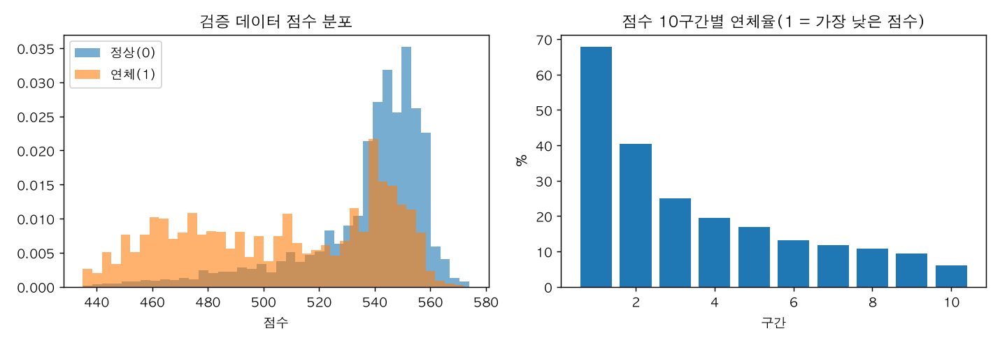

# tw-credit-scorecard

대만 신용카드 고객 3만 명의 공개 데이터로 신용평가 모형을 처음부터 끝까지 만들어 본 프로젝트입니다. 은행에서 실제로 쓰는 WoE 로지스틱 스코어카드와 그래디언트 부스팅을 같은 기준으로 비교하고, 점수표 · 거절 사유 코드 · 분포 안정성(PSI) · 공정성 점검까지 운영에 필요한 부분을 함께 만들었습니다.

## 데이터

- UCI Machine Learning Repository, [Default of Credit Card Clients](https://archive.ics.uci.edu/dataset/350/default+of+credit+card+clients) (CC BY 4.0). Yeh, I. C., & Lien, C. H. (2009).
- 대만 한 은행의 신용카드 고객 30,000명. 2005년 4~9월 6개월의 한도 · 상환 상태 · 청구액 · 납부액, 라벨은 10월 연체 여부(연체율 22.1%).
- 원본은 git 에 넣지 않습니다. `data/raw/` 에 내려받아 둡니다.

```bash
mkdir -p data/raw && cd data/raw
curl -sSLO "https://archive.ics.uci.edu/static/public/350/default+of+credit+card+clients.zip" && unzip -o *.zip && cd ../..
uv sync
uv run python src/run.py                         # 결과 → reports/
uv run python src/extra.py                       # 추가 분석 → reports/extra.json
uv run python -m unittest discover -s tests      # 시험 10개
```

## 만든 순서

| 단계 | 파일 | 내용 |
|---|---|---|
| 피처 | `src/features.sql` | DuckDB SQL 로 고객 1명 = 1행. 연체 이력(이번 달 · 6개월 최장 · 연체한 달 수), 한도 소진율, 청구 대비 납부 비율, 청구가 있는데 0원 낸 달 수, 청구액 추세 등 15개 |
| 구간화 | `src/woe.py` | 10분위에서 시작해 연체율이 한 방향으로만 움직이고 구간마다 5% 이상이 될 때까지 이웃 구간을 합침. 결측은 따로 한 구간 |
| 피처 고르기 | `src/card.py` | IV 0.02 미만 제외 → WoE 상관 0.8 넘는 쌍은 IV 큰 쪽만 → 로지스틱 계수 부호가 반대인 피처 제외 |
| 점수표 | `src/card.py` | PDO 20, 600점 = 정상:연체 50:1. 피처 · 구간마다 정수 점수, 합이 그 사람의 점수 |
| 사유 코드 | `src/card.py` | 피처별 「받을 수 있는 최고 점수 - 받은 점수」가 큰 순서로 세 개 |
| 검증 | `src/run.py` · `src/metrics.py` | 70:30 층화 분할 + 학습 데이터 5겹 교차 검증(겹마다 구간화부터 다시). AUC · Gini · KS · Brier, 점수 10구간 연체율, PSI, 승인율 80% 운영 시나리오 |

성별 · 결혼 여부 · 나이는 모형 피처로 쓰지 않고, 학습이 끝난 뒤 집단별 승인율과 연체율 차이를 점검하는 데만 씁니다.

## 결과 (검증 데이터 9,000명)

| 모형 | AUC | Gini | KS | Brier | 5겹 교차 검증 AUC |
|---|---|---|---|---|---|
| 기준선: 이번 달 연체 하나만 | 0.693 | 0.386 | 0.360 | - | - |
| WoE 로지스틱 스코어카드(피처 8개) | 0.757 | 0.514 | 0.402 | 0.140 | 0.765 ± 0.006 |
| 그래디언트 부스팅(피처 15개) | 0.782 | 0.564 | 0.433 | 0.135 | 0.787 ± 0.008 |



- 점수 10구간의 연체율이 가장 낮은 구간 67.9%에서 가장 높은 구간 6.1%까지 한 방향으로 내려갑니다. 가장 낮은 두 구간(20%)에 전체 연체자의 48.9%가 들어 있습니다.
- 학습 데이터 기준 하위 20%(508점 미만)를 거절하면 승인율 80.3%, 승인자 연체율 14.2%(전체 22.1%), 거절자 연체율 54.5%입니다. 같은 승인율에서 부스팅은 승인자 연체율 13.7%로 0.5%p 낮습니다.
- 성능 차이(AUC 0.025)와 설명 가능성 사이의 선택입니다. 이 차이는 대부분 피처 수가 아니라 모형 형태에서 옵니다. 부스팅에 스코어카드와 같은 8개만 넣어도 0.778 이고, 로지스틱에 15개를 다 넣어도 0.757 입니다(아래 「추가 분석」). 스코어카드는 점수 하나하나를 구간표로 설명할 수 있고 사유 코드가 바로 나옵니다. 부스팅을 쓴다면 같은 사유 코드를 내기 위한 설명 도구(SHAP 등)와 단조성 제약을 따로 붙여야 합니다.

### 거절 사유 코드 (거절 1,770명)

첫 번째 사유는 「이번 달 연체」 1,484명, 「한도 대비 납부액」 181명, 「카드 한도」 82명, 「청구가 있는데 0원 낸 달 수」 23명입니다. 세 사유 안에 들어간 횟수로 보면 「이번 달 연체」 1,653 · 「카드 한도」 1,249 · 「6개월 중 연체한 달 수」 1,174 순입니다.

### 공정성 점검 (승인율 80% 기준)

| 집단 | 인원 | 승인율 | 전체 연체율 | 승인자 연체율 |
|---|---|---|---|---|
| 남 | 3,563 | 79.3% | 23.9% | 15.8% |
| 여 | 5,437 | 81.0% | 21.0% | 13.2% |
| 29세 이하 | 2,882 | 77.3% | 22.5% | 13.7% |
| 30~44세 | 4,483 | 82.6% | 20.6% | 13.6% |
| 45세 이상 | 1,635 | 79.3% | 25.7% | 17.0% |

승인율 차이는 성별 1.7%p, 나이대 최대 5.3%p입니다. 같은 기준으로 승인된 사람 중 연체율은 남성이 여성보다 2.6%p, 45세 이상이 다른 나이대보다 3.3~3.4%p 높습니다. 승인자 평균 점수는 남녀 모두 약 543점으로 같고, 점수 5구간으로 나눠 봐도 모든 구간에서 남성의 연체율이 높습니다(아래 「추가 분석」). 같은 점수가 집단마다 같은 위험을 뜻하지 않는다는 신호라, 실제 운영이라면 집단별 보정(calibration) 점검을 정기 항목으로 둡니다.

### 피처 정보가치(IV) 상위

이번 달 연체 0.878 · 3개월 중 연체한 달 수 0.842 · 6개월 중 연체한 달 수 0.827 · 6개월 최장 연체 0.779 · 0원 낸 달 수 0.430. 연체 계열은 서로 상관이 0.8을 넘어 IV 가 큰 쪽만 남겼습니다(뺀 이유는 `reports/results.json` 의 `dropped`).

## 추가 분석 (`src/extra.py` → `reports/extra.json`)

위 결과를 보고 생긴 질문을 같은 분할 · 같은 설정으로 확인했습니다. 모형 선택은 바꾸지 않은 사후 분석입니다. 교차 검증은 학습 데이터 5겹입니다.

### 부스팅이 앞선 이유: 피처인가 모형인가

| 모형 | 피처 | 5겹 AUC | 검증 AUC |
|---|---|---|---|
| WoE 로지스틱 스코어카드 | 8 | 0.765 | 0.757 |
| WoE 로지스틱(고르기 없음) | 15 | 0.768 | 0.757 |
| 부스팅 | 8(스코어카드와 같음) | 0.783 | 0.778 |
| 부스팅 | 15 | 0.787 | 0.782 |
| 부스팅 + 단조 제약 | 8 | 0.781 | 0.771 |
| 부스팅 + 단조 제약 | 15 | 0.784 | 0.777 |

0.025 차이 가운데 0.021 은 같은 피처에서도 나는 모형 형태의 차이이고, 피처 수(8개 → 15개)에서 오는 몫은 0.004 입니다. 구간 안의 비선형과 피처 사이 상호작용을 로지스틱이 못 담는 것으로 봅니다. 단조 제약(값이 커질수록 위험이 한 방향으로만 움직이게)을 건 부스팅은 0.771 로, 방향은 스코어카드처럼 설명하면서 차이의 절반 남짓을 가져갑니다. 다음 후보로 둘 모형입니다. 단조 방향은 겹마다 그 겹의 학습 부분에서 순위 상관 부호로 정했고, 순서가 없는 학력 구분(4 = 기타)에는 제약을 걸지 않았습니다. 다만 사유 코드는 여전히 SHAP 같은 설명 도구가 따로 있어야 합니다.

### 같은 승인율에서 두 모형이 엇갈리는 사람 (검증 9,000명 중 위험이 낮은 7,200명 승인)

| | 인원 | 연체율 |
|---|---|---|
| 둘 다 승인 | 6,970 | 13.1% |
| 스코어카드만 승인 | 230 | 44.4% |
| 부스팅만 승인 | 230 | 30.4% |
| 둘 다 거절 | 1,570 | 57.9% |

모형을 바꾸면 스코어카드만 승인하던 230명이 빠지고 부스팅만 승인하는 230명이 들어옵니다. 결정이 바뀌는 460명 사이에서 승인자 연체가 약 32명 줄어듭니다. 승인율별 승인자 연체율 차이는 50% 에서 1.3%p, 80% 에서 약 0.5%p, 90% 에서 0.1%p 로, 승인을 넓힐수록 줄어듭니다.

### 확률 보정

스코어카드의 예측 연체율 평균 22.0%, 실제 22.1%입니다. 예측 10구간에서 예측과 실제의 차이는 가장 큰 곳이 2.7%p(9구간, 실제가 낮음)이고, 6 · 7구간은 실제가 2.4~2.6%p 높습니다. 평균은 맞지만 중간 위험대를 조금 낮게 봅니다.

### 집단별 보정 (위 공정성 점검과 같은 기준: 학습 데이터 하위 20% 경계 508점, 검증 승인율 80.3%)

| 집단 | 승인자 예측 연체율 | 실제 | 차이 |
|---|---|---|---|
| 남 | 13.6% | 15.8% | +2.2%p |
| 여 | 13.5% | 13.2% | -0.3%p |
| 29세 이하 | 14.2% | 13.7% | -0.5%p |
| 30~44세 | 13.1% | 13.6% | +0.4%p |
| 45세 이상 | 13.6% | 17.0% | +3.3%p |

차이는 반올림 전 값으로 계산했습니다. 점수 5구간으로 나눠도 남성은 다섯 구간 모두에서 여성보다, 45세 이상은 다섯 구간 모두에서 다른 나이대보다 연체율이 높습니다. 모형이 남성과 45세 이상의 위험을 낮게 잡는다는 뜻입니다. 보호 속성을 피처로 넣는 것은 답이 아니고, 어떤 피처가 이 차이를 만드는지 찾고 집단별 보정을 운영 점검에 넣는 것이 다음 할 일입니다.

## 한계

- **시점이 하나뿐**: 6개월 이력과 다음 달 연체가 한 번뿐이라, 다른 시기로 검증하는(out-of-time) 평가를 할 수 없습니다. 학습 · 검증 PSI 는 점수 0.0003, 피처 최대 0.002 로 무작위 분할이라 당연히 작습니다. PSI 는 운영 감시용 코드로 만들어 둔 것입니다.
- **승인된 사람만 있음**: 카드를 이미 받은 고객 데이터라, 거절된 사람의 결과를 모릅니다(reject inference 문제). 신규 심사 모형이라면 이 편향을 따로 다뤄야 합니다.
- **라벨이 「다음 달 연체」**: 실무의 부도 정의(예: 90일 이상 연체, 12개월 관찰)보다 훨씬 짧습니다.
- **소득 정보가 없음**: 소득 추정은 이 데이터로 할 수 없습니다.
- 2005년 대만 데이터라 지금 고객에 그대로 맞지 않습니다. 방법과 검증 절차를 보여 주는 용도입니다.

## 만든 방식

Claude Code 로 구현했습니다. 버그 하나를 시험으로 막아 두었습니다: DuckDB 의 `least()` 가 NULL 을 무시해서, 직전 청구가 0원인 고객의 납부 비율이 「전액 납부(1.0)」로 들어가던 것을 `CASE` 로 고치고 시험(`test_pay_ratio_null_when_no_previous_bill`)을 붙였습니다.

## 커밋 번호 안내

공개 전에 커밋 작성자 표기만 바꿨습니다(파일 내용 · tree 는 그대로). 그 전에 다른 문서에 적힌 커밋 번호는 아래처럼 읽습니다.

| 전 | 지금 |
|---|---|
| 0b531eb | 1e6cb63 |
| 94ac0bf | 51ee0e8 |
